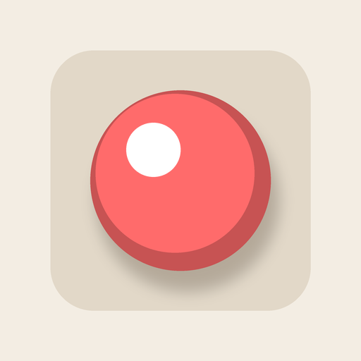

<p align="center">
	
</p>

<p align="center">
	A calm marble puzzle. Tilt the board, roll every marble home.
</p>

<p align="center">
	<a href="https://chaosmos.studio/plumb/">Website</a> |
	<a href="https://chaosmos.studio/plumb/play/">Play in the browser</a>
</p>

Swipe and the whole board tilts: every marble rolls until a wall, the edge or another marble stops it, and
drops into a hole of its own colour. Clear the board in as few tilts as you can.

## Features

- Every level generated and proven solvable by a solver, with the shortest route as par
- No level repeats another. The main path climbs gently, then holds, and a Hard section keeps the steep climb
- A hint that shows where every marble would land, undo and restart any time
- Light and dark themes, sound, music and vibration you can switch off
- Ads and a one-time Supporter pack on Android; no ads in the browser

## Stack

- Godot 4.7, GDScript, GL Compatibility renderer
- The shared puzzle kit in `kit/` (screens, sheets, ads, billing)
- Generated art, sound and music (`tools/`)

## Run

```bash
godot --path .                                          # play
godot --headless --path . -s res://tests/run_tests.gd   # tests
```

`PLAN.md` has the design, `MATH.md` the rules, solver and generator, and `CHANGELOG.md` the releases.
