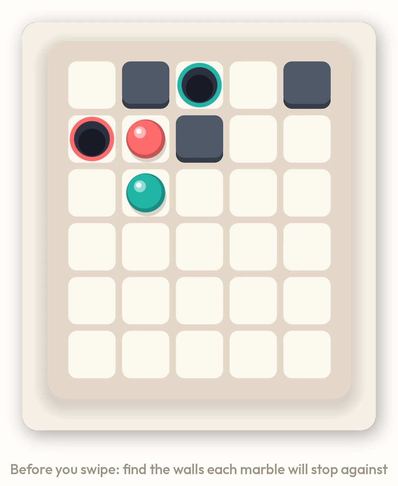
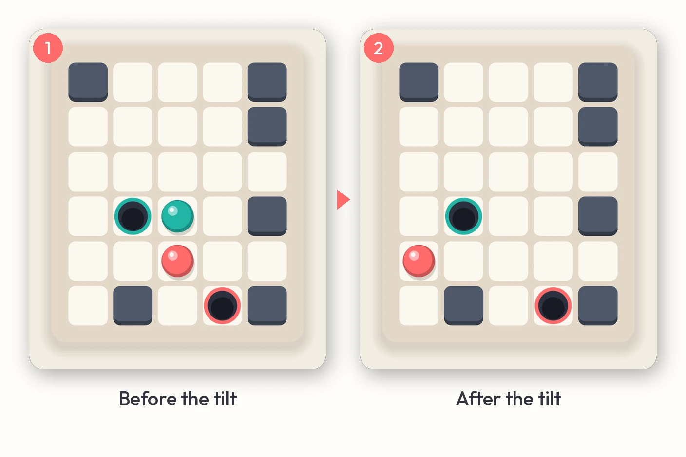
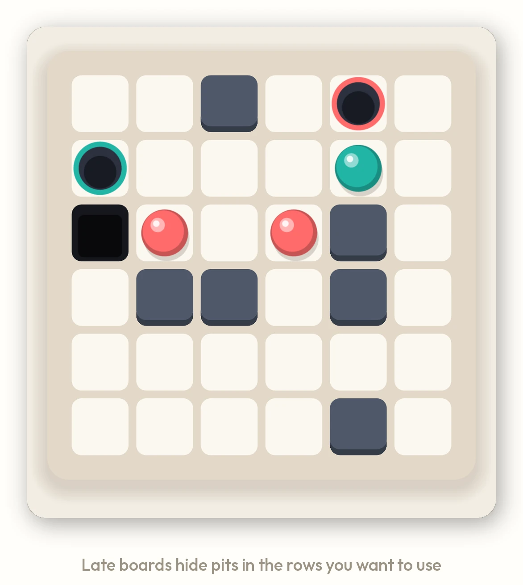

Plumb has one rule, but reading a board takes practice. These seven habits make the early levels click, and they keep working on the hard ones.

## 1. Find the stopping points first

A marble only ever stops against something: a wall, the edge, or another marble. So before you swipe, look at each marble and ask, for each of the four directions, where would it stop? Those few squares are the only places it can be after one move.

## 2. Every swipe moves everything

It is easy to plan one marble and forget the others. Before each tilt, check what happens to **every** marble, not just the one you are thinking about. A great move for the red marble can undo two moves of work on the teal one.

## 3. Park, then drop

Good routes usually have two kinds of move. A **park** puts a marble against a wall that lines it up with its hole. A **drop** rolls it in. If you cannot drop a marble yet, ask where you could park it so that a later tilt drops it.

## 4. Marbles are walls too

A marble stops the marble behind it. That means you can use one marble as a temporary wall for another, and it also means a marble can block a route you were counting on. When two marbles line up, pay attention to which one moves first.

## 5. Opposite tilts are not free undo

Tilting left and then right rarely puts things back where they were, because each marble slides until it stops, and the stopping points differ by direction. If you want the previous position, use **undo**, not the opposite swipe.

## 6. Treat pits as walls you cannot touch

On later boards, square pits swallow any marble that rolls over them. The trick is to see a pit as a line you must never roll along. Plan routes that stop marbles **before** the pit's row or column, or that pass it on another line.

## 7. Undo is a thinking tool

There is no penalty for undo, and your move count goes back with it. Use it to test ideas: tilt, look, undo. After a few tries you will know the board, and the solve comes fast. If you are truly stuck, the [hint](../how-the-hint-works/) shows one good move without giving the whole level away.

Ready for the next step? [How to get three stars](../three-stars-and-par/) turns these habits into a method for the perfect route.
