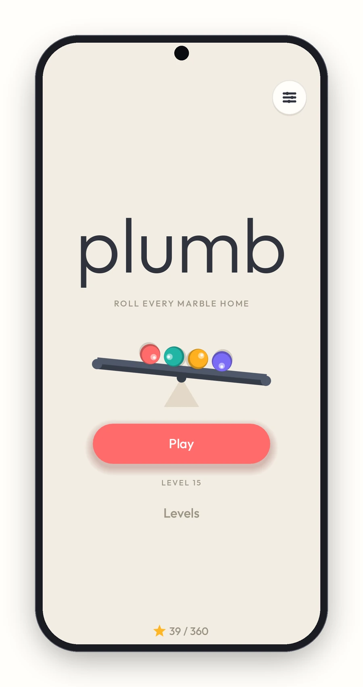
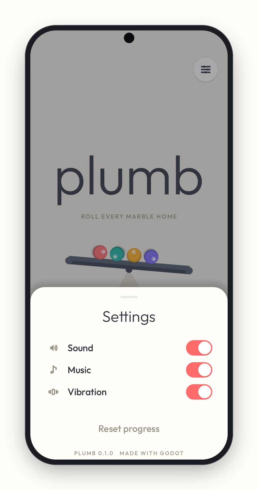
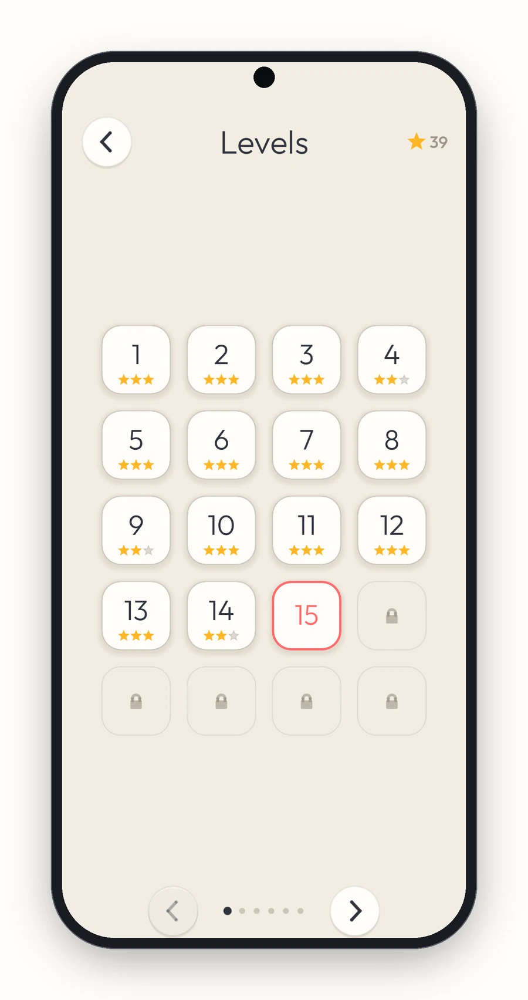

Many mobile puzzle games are built to keep you anxious: a countdown, a limited number of lives, an energy bar that refills if you wait or pay. Plumb has none of those. That was the first decision we made, and everything else follows from it.

## No timer

A puzzle is about the moment you see the answer. A timer turns that moment into a race, and it punishes the careful reading that makes Plumb satisfying. So there is no clock. Take a minute, take ten.

## No lives

Falling into a pit costs you a move, not a life. [Undo](../pits-undo-and-restart/) takes it back, as many times as you like. You never have to wait, watch an ad or pay to try again.

## Ads that stay out of the way

Plumb is free, and the Android app pays its way with a few ads. We put them where they never touch a puzzle:

- a banner at the bottom of the level list, and nowhere else;
- now and then an ad between levels, only after you tap **Next level** on a solved board, and never before you have solved the first dozen;
- a short video you can choose to watch for an extra hint, once the day's free hints are used.

No ad ever appears while you play, over the board, or after a marble falls. If you would rather have none at all, the **Supporter pack** is a one-time purchase in the app that turns them off for good and makes every hint free. The web version never shows ads.

The game itself still does not know who you are. There is no account, and your progress stays on your device. The ads come from Google, which collects some data to show them; the [privacy policy](../../privacy/) explains what, and how to change your choices.

## Quiet by default, and yours to change

The look is paper and marbles, with soft shadows and one typeface. The sounds are gentle clicks and rolls, and the music is an ambient loop you can switch off.

Settings opens from the gear on every screen, even halfway through a level, so you never have to leave a puzzle to turn the music down. In it you can:

- turn sound, music and vibration on or off, each with one switch;
- pick the theme: **Light** is the warm paper Plumb was designed in, **Dark** is the same room at dusk, and **Auto** follows your phone;
- replay the first level's short guide from **How to play**;
- in the Android app, open the Supporter pack from **Support the game**, or change your choice about ads from **Privacy choices**, where the law asks for one.

Nothing else asks for your attention.

## Progress you can see

The level grid shows every level you have played and the stars you earned. The next level to play is marked, and anything you have unlocked you can replay for a better score.

## Offline, anywhere

Plumb plays fully offline, so it works on a plane, underground or anywhere your signal is not. If you want to try it before installing, it also runs in your browser.
