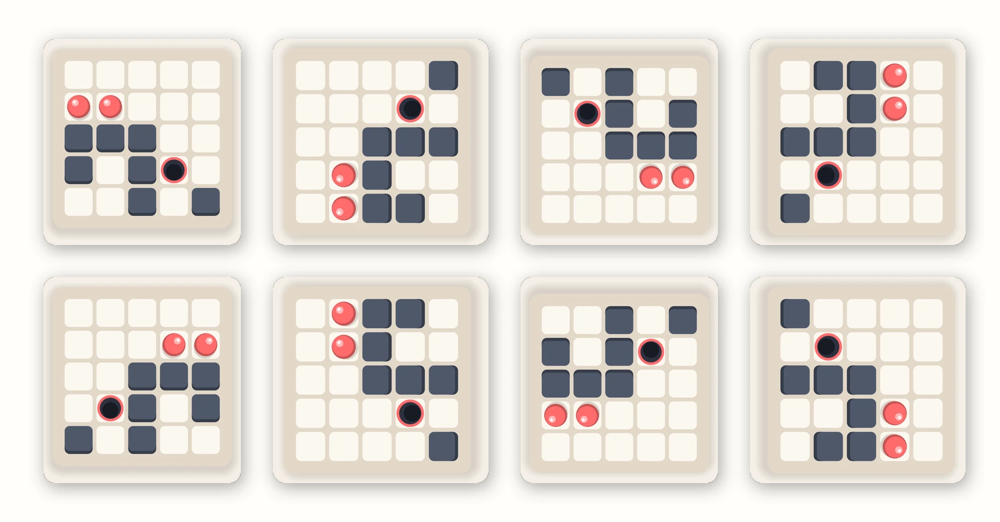
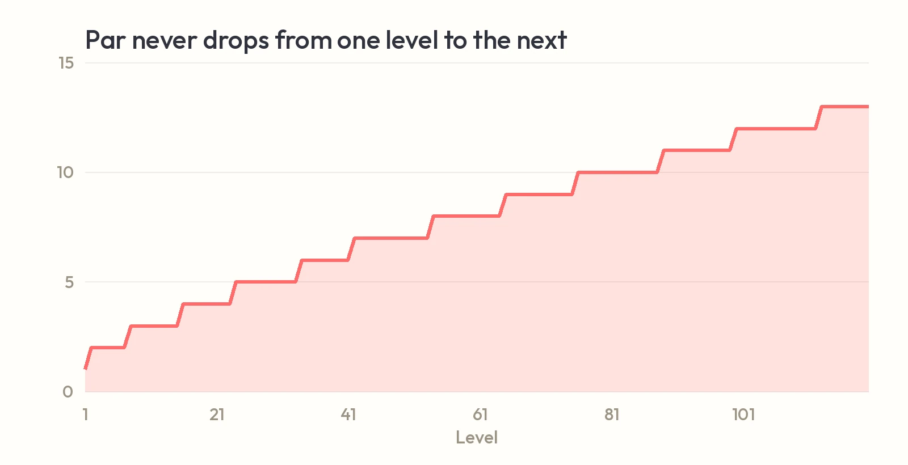
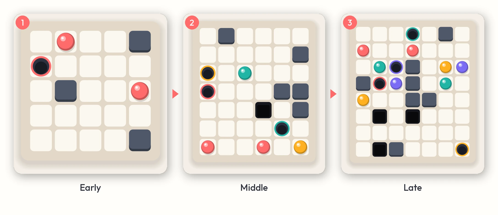

Nobody designed Plumb's levels by hand. A program makes them, another program proves each one can be solved, and a set of rules decides which ones ship and in what order. This post walks through how that works, and what we changed after players noticed some levels felt the same.

## Step 1: propose a board

The generator starts from a recipe for a stage of the game: a board size, a number of marbles and colours, how many walls, and whether there are pits. It scatters walls, holes and marbles at random within that recipe. Most of these boards are no good, and that is fine.

## Step 2: prove it can be solved

Every candidate goes to the **solver**. It explores every sequence of tilts breadth first, so the first solution it reaches is a shortest one. If there is no solution, or the shortest one is too short or too long for this stage, the board is thrown away. If it passes, its shortest solution length becomes its **par**.

The tests re-solve every shipped level on every build, so a change to the rules can never quietly break a level.

## Step 3: make sure it is new

Early on, some levels were near-copies of each other: two boards a couple of cells apart, or the same board turned sideways. Players noticed quickly. So every candidate now has to pass a novelty check against every level already chosen.

The check treats a board and its rotations and mirror images as the same level, and ignores which colour is which:

Two boards of the same size must also differ in at least 30% of their cells. And if one board's shortest solution, turned to match, also solves the other in the same number of moves, they must differ in at least half their cells, because they would play the same even if they look different.

## Step 4: order them so it never gets easier

A level's difficulty is measured, not guessed. We use a score we call **bits of luck**: how unlikely it is that someone tilting at random, among the tilts that move something, would solve the board in exactly par. It is computed exactly from the solver's search. It tracks par closely, but it also rises when a board has more tempting wrong moves, and falls when there are many ways to reach par.

The levels are then chosen and ordered so that par and the score **never drop** from one level to the next, and the board size, colours, marbles and pits only ever increase.

New ideas arrive gently. The second marble appears at level 9, the second colour at level 17 and the first pit at level 35, and each one first shows up on a board that is easy for its position.

## Why do it this way?

Because it makes promises we can test. Every level is solvable. Par is the true minimum. No two levels are the same puzzle. And the game never takes a step backwards in difficulty. A person checking a hundred boards by eye would miss some of these; a test does not.

If you like the maths side of this, read [why four directions go so deep](../why-four-directions-go-deep/).
