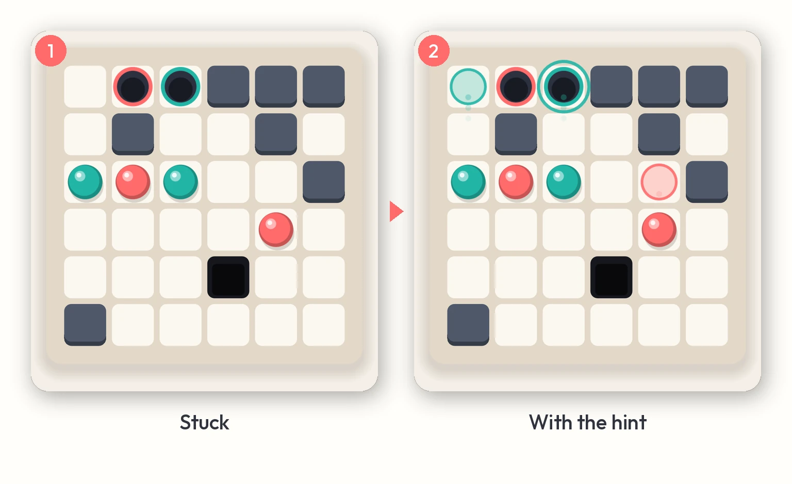
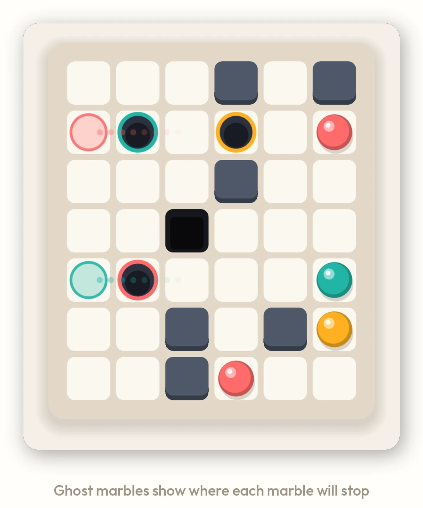
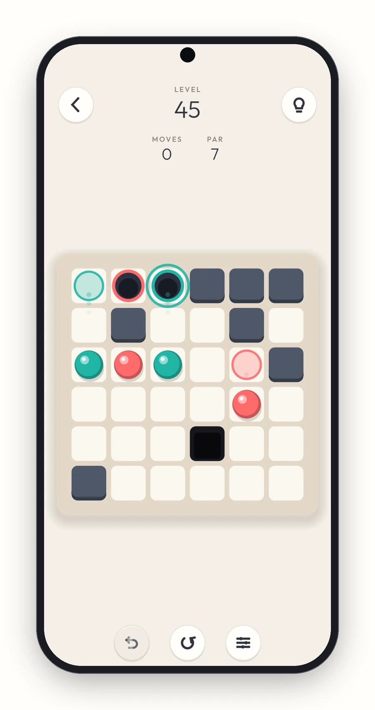

Every level in Plumb has a hint, and it is always available. Tap the light bulb in the top right corner. This post explains what you see, and how to get the most from it without spoiling the puzzle.

## What the hint shows

The hint is a **preview of your best next tilt**, drawn on the board itself:

- **Ghost marbles** appear where each marble will stop.
- **Dotted trails** show the path each marble rolls along.
- **Rings** mark a marble that will drop into its hole on this tilt.
- A **red ring** warns you if a marble would fall into a pit.
- The board gives a small **nudge** in the hinted direction, so you know which way to swipe.

## Where the hint comes from

The hint is not a pre-recorded answer. When you ask, the game runs its solver on the board **as it is right now**, finds a shortest route from here to a solved board, and shows you the first tilt of it.

That has two nice consequences. The hint always fits your current position, even after a detour. And if you follow the hint from the very start of a level, you will solve it in par, for three stars.

## It always answers

If the marbles are still rolling when you tap, the hint waits for them to stop, then answers. If a marble has already fallen into a pit, there is no route left, so the hint tells you so and suggests undo or restart instead of leaving you guessing.

## When to use it

- **When you are stuck on the first move.** One tilt is often all you need to see the idea.
- **After a solve over par.** Replay, and use the hint for the move you are unsure of.
- **Not every move.** The satisfying part of Plumb is the "oh, that's how" moment. Try a couple of tilts and an undo first, and keep the hint for when you are really stuck.

For the habits that make you need the hint less, see [seven beginner tips](../beginner-tips/).
