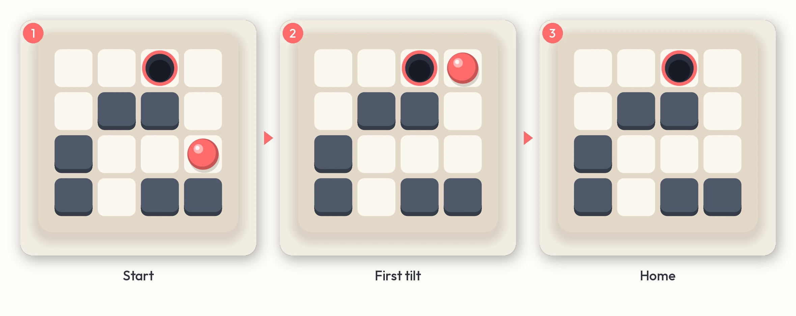
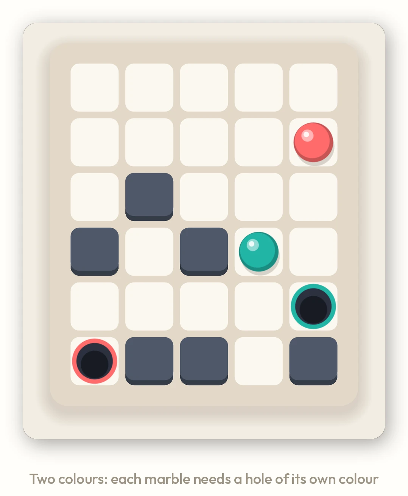
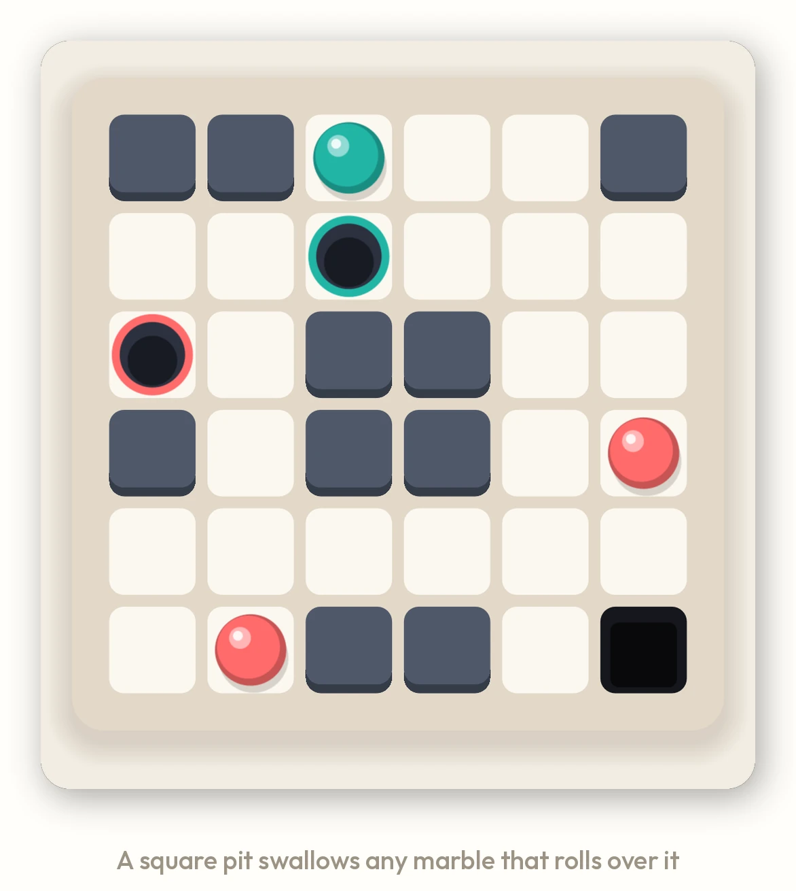

Plumb is a puzzle about gravity. There is a board, a few marbles and a few holes, and one thing you can do: tilt the board. That is the whole control scheme, and it is enough for a game that gets surprisingly deep.

This guide covers everything you need to play your first levels. It takes about two minutes to read, and less to try. Level 1 also opens with a short guide on the board itself, which you can skip and replay any time from **How to play** in Settings.

## One swipe moves every marble

Swipe up, down, left or right, and the board tilts that way. **Every marble on the board rolls at once**, in the direction you swiped, and keeps rolling until something stops it: a wall, the edge of the board, or another marble.

That last part is the heart of the game. You never move one marble on its own. Each swipe moves all of them, so every move is a small chain of consequences you have to read before you make it.

## Each marble has a home

Holes come in colours. A marble drops into a hole of **its own colour** the moment it rolls over one, even in the middle of a roll. A hole of a different colour is just floor to it.

One hole can take every marble of its colour, so two red marbles can both end up in the same red hole. Get every marble home and the level is solved.

## Watch out for pits

Later levels add **square pits**. A pit swallows any marble that rolls over it, whatever its colour, and that ends the attempt. You will see pits for the first time around level 35, once you are comfortable with how marbles roll.

Losing a marble is not a big deal. **Undo** takes back your last tilt, and **restart** puts the whole board back. There are no lives and no timer, so a mistake only costs you a second. There is more on that in [pits, undo and restart](../pits-undo-and-restart/).

## Moves, par and stars

The top of the screen shows two numbers: your **moves** so far, and the level's **par**. Par is the fewest moves that solve the level, found by a computer that checked every possible sequence of tilts.

- Solve it in par and you earn **three stars**.
- A few moves over par still earns **two**.
- Any solve earns **one**, and unlocks the next level.

[How to get three stars](../three-stars-and-par/) explains exactly how the scoring works.

## Stuck? Ask for a hint

Tap the light bulb at the top right and the board shows your best next tilt: ghost marbles where each marble will stop, dotted trails along the way, and a warning ring on any marble that would fall into a pit. It never solves the level for you, it just shows you one good move. [Here is how the hint works](../how-the-hint-works/).

## Your first five minutes

1. Swipe in each direction on the first level, just to watch how the marble moves.
2. Before each swipe, trace where each marble will stop. That habit is the whole skill.
3. Use undo freely. Trying a tilt to see what happens is how you learn a board.
4. Don't chase three stars yet. Solve first, then come back for the perfect route.

That's it. Plumb is free on Google Play and plays in your browser too. The levels start gentle and get steadily harder, and no two of them are the same.
