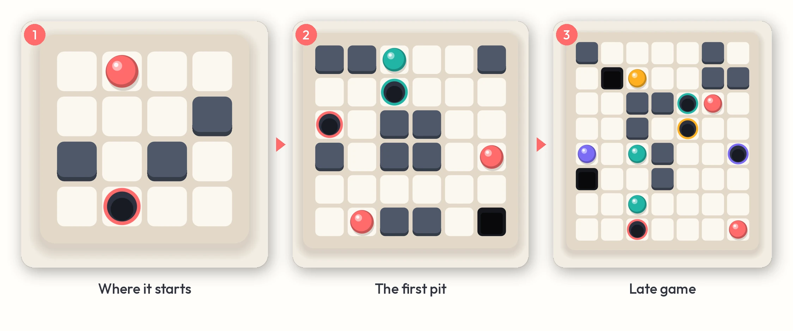
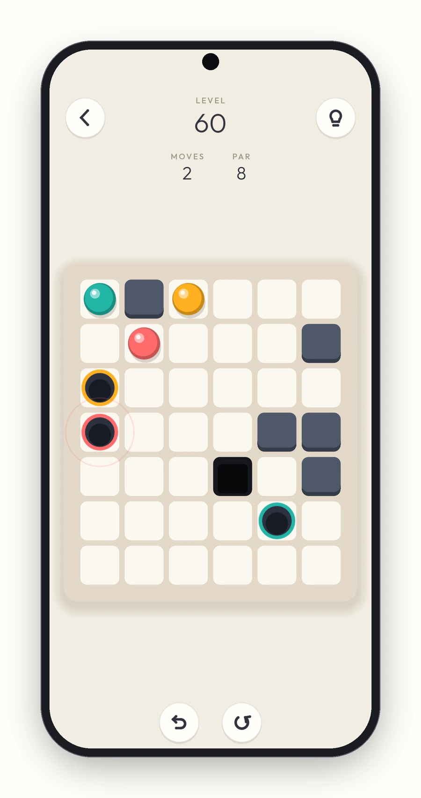

Plumb is made by a team of two. One of us is a person, Shravan Goswami. The other is Claude Opus 5.5, an AI model made by Anthropic, working with Shravan in Claude Code. This post is about how that works, told as plainly as we can.

## Who does what

**Shravan** decides what the game is. He picked the idea, sets the direction, plays every build on a real phone, and decides what stays in and what goes. When something feels wrong, like levels that seemed to repeat, he says so, and that becomes the next piece of work.

**Claude** writes most of the code: the rules, the solver, the level generator, the user interface, the tests, the tools that make screenshots and videos, and this website. It explains its choices in the project's design notes, so the code stays something a person can study and change.

## How a feature gets made

A typical change goes like this. Shravan describes what he wants, often in a sentence or two. Claude reads the relevant code and notes, makes the change, and then checks it: the rules and levels are tested without a screen, and anything visual is rendered to an image and looked at before it is called done. Small changes are committed one at a time, so every step can be traced and undone.

## What the AI is good at here

- Exploring many options quickly, then measuring them, like trying generator settings until the difficulty curve is smooth.
- Being thorough in the boring places: checking every level for repeats, re-solving every board on every build.
- Writing the tools around the game, so screenshots, store images and trailers come straight from the real game.

## What stays human

Taste. Whether a colour is right, whether a level is fun, whether the game feels calm. Those calls are Shravan's, made by playing, and the code follows them.

## Why tell you this?

Because you should know who made the things you play, and how it is paid for. Plumb is free to play. The Android app has a few ads, never during a puzzle, and a one-time Supporter pack that turns them off; the web version never shows ads. If you have thoughts on the game, or on how it was made, [leave a comment on the support page](../../support/). Both of us read them.
