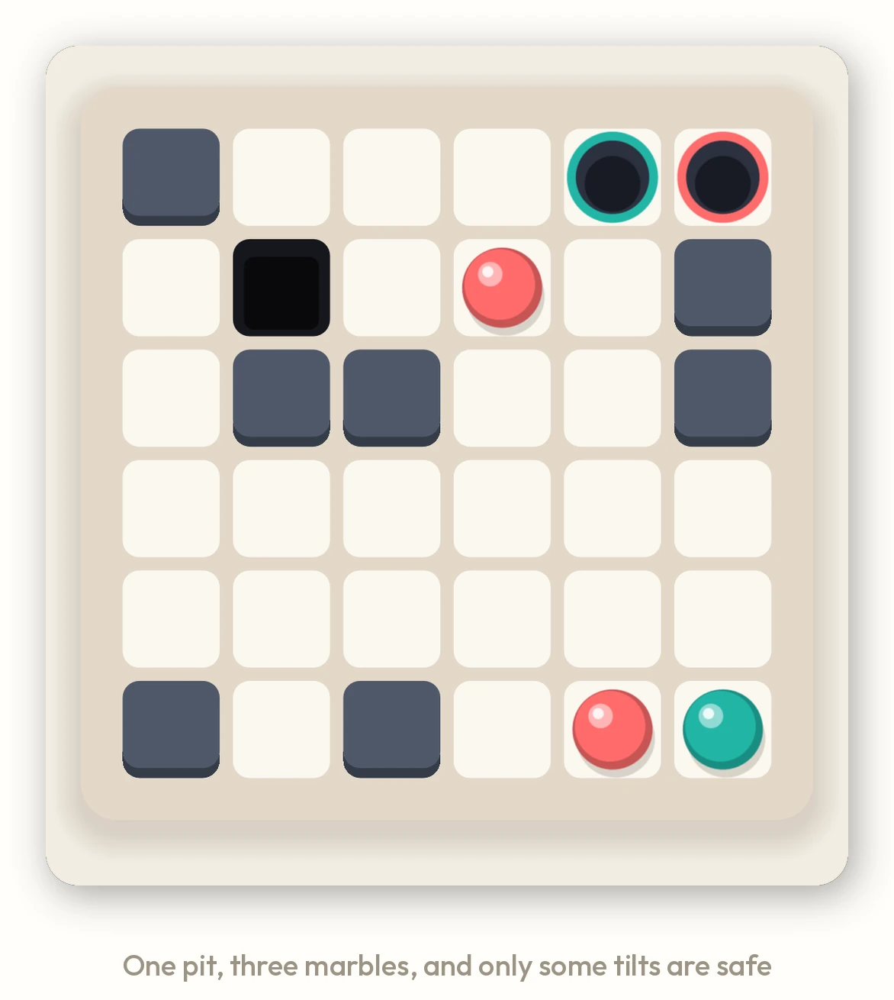
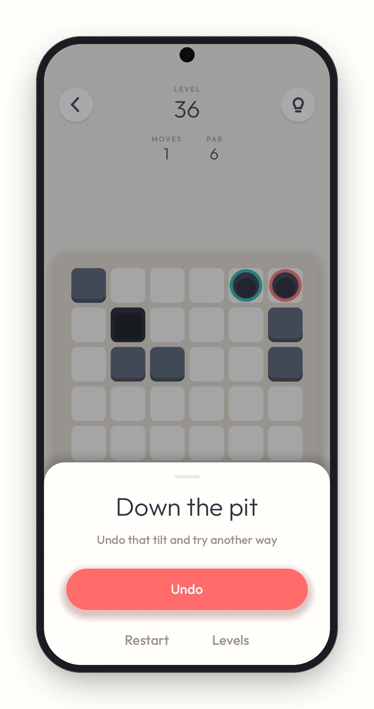

Around level 35, Plumb adds its only hazard: the **square pit**. This post explains how pits work and why you should never be afraid of them.

## How pits work

A pit is a dark square in the board. Any marble that rolls over one falls in, whatever its colour. Unlike a hole, a pit does not care about colour, and a marble in a pit is lost, so the attempt is over.

Pits change how you read a board. A line that used to be a safe run to a wall is now a trap if a pit sits on it. The first pit level is deliberately easy for where it comes, so you can learn the new rule without also fighting a hard board.

## When a marble falls

If a marble falls, the game tells you straight away and offers the fastest way back: **undo** that tilt. You can also restart or go back to the levels. Nothing is lost except the move.

## Undo and restart

- **Undo** takes back your last tilt, and your move count goes back with it. You can undo as many times as you like.
- **Restart** puts every marble back where the level started, and resets the count.

Because undo also takes back the move count, experimenting never costs you stars. Try a tilt, see what happens, undo. That loop is the fastest way to understand a hard board.

## Why there are no lives

Plumb has no lives, no hearts and no timer. A pit is a lesson about the board, not a punishment. We wanted a puzzle you can play at your own pace, where the only thing that matters is the moment the route becomes clear. There is more on that in [calm by design](../calm-by-design/).

## Three pit habits

1. **Check every line before a tilt.** For each marble, follow its roll to where it stops. If a pit is on that line, do not tilt that way yet.
2. **Use marbles as shields.** A marble parked in front of a pit stops the next one before it gets there.
3. **Let the hint warn you.** The [hint](../how-the-hint-works/) rings any marble that would fall on the tilt it suggests, and it never suggests a losing tilt.
