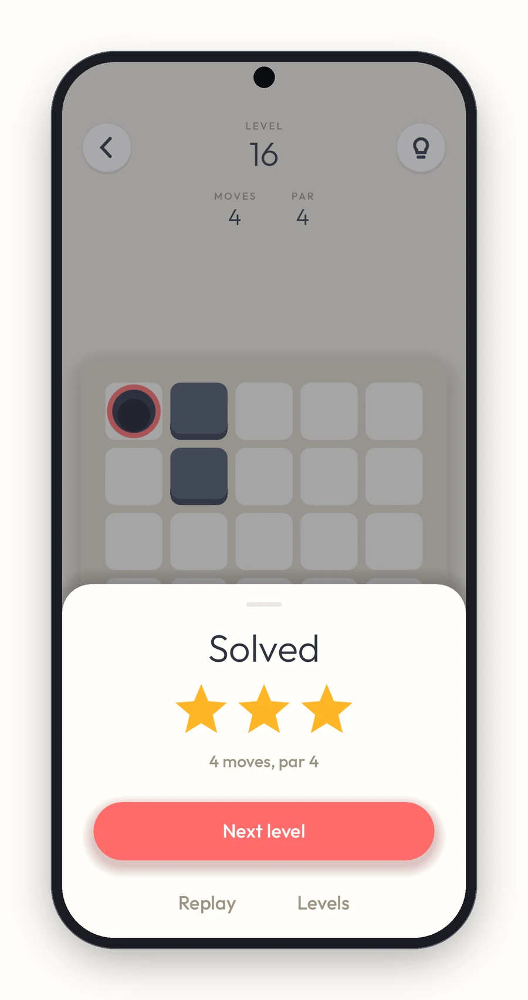
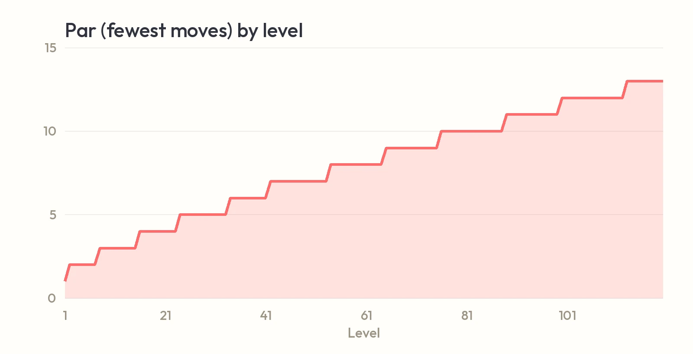
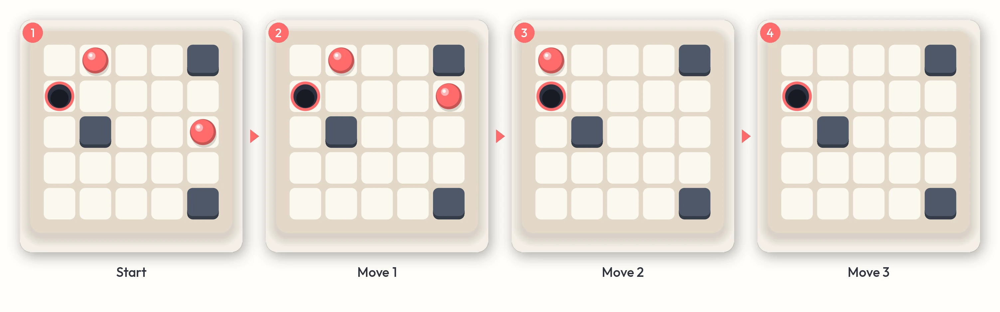

Every Plumb level shows two numbers while you play: your moves, and **par**. Three stars means matching par. This post explains where par comes from, how the stars are counted, and how to find the perfect route more often.

## What par is

Par is the **fewest tilts that solve the level**. It is not a guess or a designer's target. When a level is made, a solver tries every possible sequence of tilts, breadth first: every one-move sequence, then every two-move sequence, and so on, until it finds a sequence that gets every marble home. The first solution it finds is a shortest one, and its length is par.

So par is always achievable, and never beatable. If you solve a level in par, you found one of the best routes that exist.

## How the stars are counted

| Your moves | Stars |
| --- | --- |
| Par or fewer | 3 |
| Up to par plus a leeway | 2 |
| Anything more | 1 |

The leeway for two stars grows with the level: it is half of par, rounded up, and never less than 2. On a par 4 level you get two stars for up to 6 moves; on a par 12 level, up to 18. A long board has more room for a sensible detour, and the scoring allows for that.

Every solve earns at least one star, and one star is enough to unlock the next level. You never have to be perfect to keep going.

## Par gets longer, steadily

The chart below is par for every level in order. It climbs one step at a time and never drops: each level needs at least as many moves as the one before.

## A worked example: a par 3 level

Here is level 10 solved in its par of three moves. Watch what each tilt is for.

The pattern is common: the first tilt usually **parks** a marble somewhere useful, lining it up with its hole, and the later tilts **drop** marbles home, often two at once.

## A method for the perfect route

1. **Work backwards from the holes.** For each hole, ask which wall or marble a marble could stop against to land on it. That is where it has to come from.
2. **Look for shared tilts.** The best routes use one swipe to do two jobs: drop one marble while parking another.
3. **Count the marbles that move.** A tilt that moves nothing useful is a wasted move. A tilt that moves a marble away from its line costs you two.
4. **Use undo to test.** Trying a tilt and undoing it costs nothing, and the move counter goes back too.
5. **Replay after a one-star solve.** You now know the board. The second attempt is often par.

If you are stuck on the first move, the [hint](../how-the-hint-works/) shows the first tilt of a shortest route, so following hints alone always solves a level in par.
