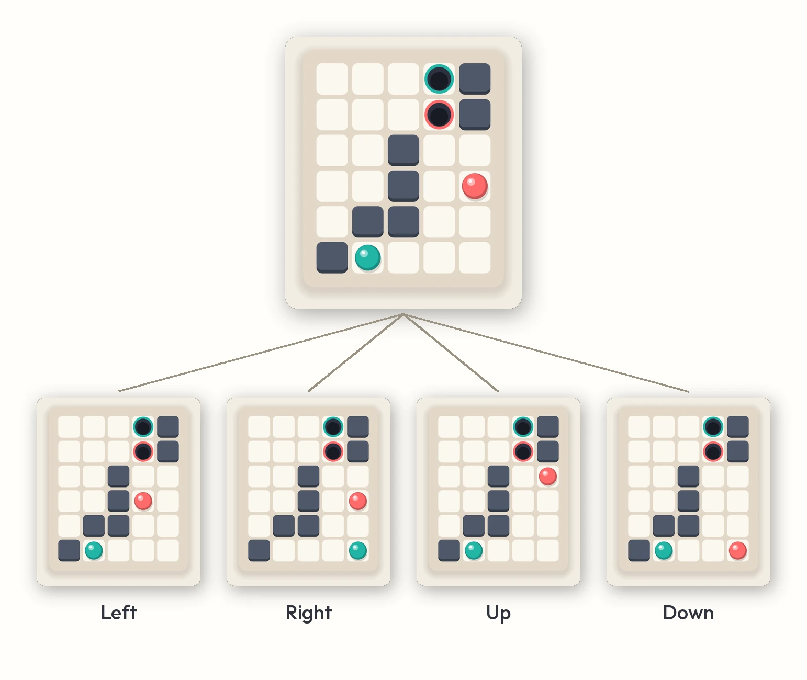
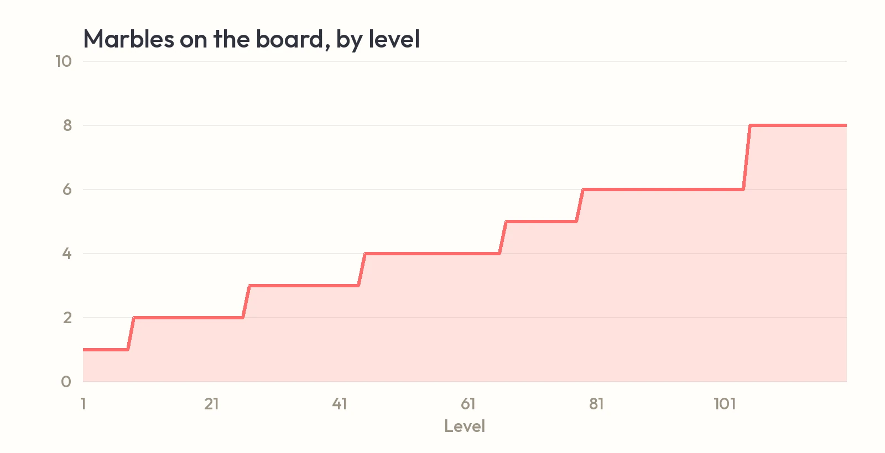

Plumb gives you four moves: up, down, left and right. That sounds like it should run out fast. It does not, and the reason is the one rule that makes Plumb different: **every marble moves at once**.

## A tree of possibilities

From any position there are at most four tilts, and each one leads to a new position. From each of those, four more. Draw it out and you get a tree:

After two moves there are up to 16 sequences, after three up to 64, and after ten more than a million. The deepest Plumb levels need 13 tilts. Of course, not all of these sequences lead anywhere new:

- A tilt that moves nothing leaves the board as it was.
- Two sequences can reach the same position by different routes.
- A marble that drops home stays home, so some positions can never come back.

## Positions, not sequences

This is why the game's solver thinks in **positions**, not in sequences. It explores breadth first: every position one tilt away, then every position two tilts away, and so on, and it never visits the same position twice. The first time it reaches a solved board, it has found a shortest route, and that length is the level's par.

A position in Plumb is just where the remaining marbles are. The walls, holes and pits never move. So the solver only has to remember the marbles, which keeps it fast enough to check every level in a fraction of a second.

## Why moving everything makes it hard

If each swipe moved one marble, you could solve marbles one at a time. Because each swipe moves all of them, **moves interfere**. Parking one marble drags the others along, and the best route is the one where every tilt does useful work for several marbles at once.

As levels go on, the number of marbles grows, and so does that interference:

## Measuring difficulty

Par alone does not tell you how hard a level feels. A long route can be obvious, and a short one can hide behind a lot of tempting wrong moves. So Plumb also measures each level in **bits of luck**: how unlikely a random player would be to solve it in par. Each extra bit halves the chance. The levels are ordered so this never goes down; [how the levels are made](../how-plumb-levels-are-made/) has the details.
